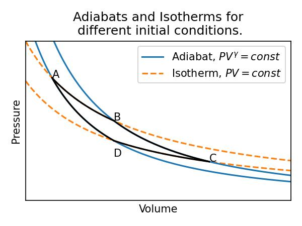
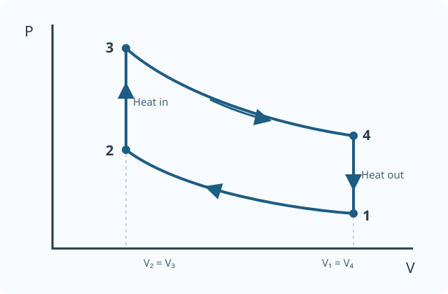



# Thermodynamic cycles

## Topics

- Heat engines, work and thermal efficiency
- Carnot cycle and the second-law limit
- Air-standard Otto, Diesel and Brayton cycles
- Rankine cycle for steam power

A **thermodynamic cycle** is a sequence of processes that returns a working
substance to its initial state. Heat engines use such cycles to convert part
of an energy input into useful work. This page compares idealized cycles; real
engines and power plants have additional losses.

## Energy and sign conventions

The notes use work **done on** the system as positive:

$$
\Delta U = Q + W_{\rm on}.
$$

Over a complete cycle, $\Delta U=0$. For a heat engine, let $Q_{\rm in}$
and $Q_{\rm out}$ be positive magnitudes of heat supplied and rejected, and
let $W_{\rm net,out}$ be the positive net work output. Then

$$
W_{\rm net,out}=Q_{\rm in}-Q_{\rm out},
\qquad
\eta_{\rm th}=\frac{W_{\rm net,out}}{Q_{\rm in}}
=1-\frac{Q_{\rm out}}{Q_{\rm in}}.
$$

For a closed, quasi-static cycle with pressure-volume work, the net work
output is $\oint P\,{\rm d}V$: the area enclosed on a $P$–$V$ diagram.
A clockwise loop produces positive net work output. This area rule does not
directly represent the shaft work of an open-flow turbine cycle.

An **adiabatic** process has no heat transfer; **isentropic** means constant
entropy. A reversible adiabatic process is isentropic, but an irreversible
adiabatic process need not be.

## Carnot cycle

The Carnot cycle is a fully reversible engine cycle operating between two
constant-temperature reservoirs, at $T_{\rm H}$ and $T_{\rm L}$, where
$T_{\rm H}>T_{\rm L}$. For an ideal-gas working substance it consists of:

1. **Isothermal expansion at $T_{\rm H}$:** the gas absorbs $Q_{\rm H}$ and
   does work.
2. **Isentropic expansion:** the gas cools from $T_{\rm H}$ to $T_{\rm L}$
   without heat transfer.
3. **Isothermal compression at $T_{\rm L}$:** the gas rejects $Q_{\rm L}$.
4. **Isentropic compression:** work is supplied to bring the gas back to
   $T_{\rm H}$ and its initial state.

For reversible heat transfer, $\Delta S=Q_{\rm rev}/T$. The net entropy
change of the working substance over the cycle is zero, so

$$
\frac{Q_{\rm H}}{T_{\rm H}}=\frac{Q_{\rm L}}{T_{\rm L}},
\qquad
\boxed{\eta_{\rm Carnot}=1-\frac{T_{\rm L}}{T_{\rm H}}}.
$$

Temperatures must be absolute, in kelvin. For example, reservoirs at
$600\ \mathrm{K}$ and $300\ \mathrm{K}$ give an efficiency of $0.50$, or
50%. This is the upper bound for any engine operating **between those two
reservoir temperatures**, not a prediction for a real engine. See
[Lecture 5](Lecture_05.html) for the derivation and the second law.

## Air-standard assumptions

The Otto, Diesel and Brayton models below use **air-standard** assumptions:
air is treated as an ideal gas in a closed cycle; external heat addition
replaces combustion, and heat rejection returns the air to its initial
state. The ideal compression and expansion processes are reversible and
adiabatic. For the efficiency formulas below, we additionally assume
constant specific heats, with $\gamma=C_P/C_V$.

These are models of engine behaviour, not literal descriptions of the
combustion, intake and exhaust processes in a real engine.

## Air-standard Otto cycle

The Otto cycle is an idealization of a spark-ignition piston engine. Its
distinctive feature is **constant-volume heat addition**.

1. **1 → 2: isentropic compression.** The piston compresses the air from
   $V_1$ to $V_2$; pressure and temperature rise.
2. **2 → 3: constant-volume heat addition.** Heat is supplied and the
   pressure and temperature rise.
3. **3 → 4: isentropic expansion.** The gas expands back to $V_1$, producing
   work.
4. **4 → 1: constant-volume heat rejection.** Heat leaves the air, returning
   it to its initial state.

Define the **compression ratio** $r=V_1/V_2>1$. Since $V_3=V_2$ and
$V_4=V_1$, the isentropic ideal-gas relation $TV^{\gamma-1}=\text{constant}$
gives

$$
\frac{T_2}{T_1}=r^{\gamma-1},
\qquad
\frac{T_3}{T_4}=r^{\gamma-1}.
$$

At constant volume, heat transfers are $Q_{\rm in}=nC_V(T_3-T_2)$ and
$Q_{\rm out}=nC_V(T_4-T_1)$. Substituting these into the efficiency gives

$$
\boxed{\eta_{\rm Otto}=1-\frac{1}{r^{\gamma-1}}}.
$$

For $r=8$ and $\gamma=1.4$, the ideal efficiency is approximately **56.5%**.
Increasing $r$ increases this ideal efficiency, but real spark-ignition
engines are constrained by knock, heat losses and other effects. This result
does not contradict the Carnot limit: the Otto cycle adds and rejects heat
over ranges of temperature, rather than at two fixed reservoir temperatures.

## Air-standard Diesel cycle

The Diesel cycle is an idealized compression-ignition engine cycle. It differs
from the Otto cycle in how heat is added:

1. **1 → 2:** isentropic compression.
2. **2 → 3:** constant-pressure heat addition; volume increases.
3. **3 → 4:** isentropic expansion back to $V_1$.
4. **4 → 1:** constant-volume heat rejection.

With compression ratio $r=V_1/V_2$ and **cut-off ratio**
$\rho=V_3/V_2$, the constant-specific-heat air-standard efficiency is

$$
\boxed{\eta_{\rm Diesel}
=1-\frac{1}{r^{\gamma-1}}
\frac{\rho^\gamma-1}{\gamma(\rho-1)}}.
$$

Here $1<\rho<r$. At the same $r$ and $\gamma$, the ideal Diesel efficiency
is lower than the ideal Otto efficiency for $\rho>1$. Real diesel engines
can nevertheless use higher compression ratios; actual performance depends on
more than this idealized comparison.

## Air-standard Brayton cycle

The Brayton cycle models a gas turbine. Its four ideal processes are

1. **1 → 2:** isentropic compression.
2. **2 → 3:** constant-pressure heat addition.
3. **3 → 4:** isentropic expansion.
4. **4 → 1:** constant-pressure heat rejection.

For constant specific heats, with pressure ratio $r_p=P_2/P_1=P_3/P_4$,

$$
\boxed{\eta_{\rm Brayton}
=1-\frac{1}{r_p^{(\gamma-1)/\gamma}}}.
$$

Actual gas turbines generally operate as open systems: a compressor and
turbine exchange shaft work with flowing gas, and combustion replaces the
ideal heat-addition process. Compressor and turbine irreversibilities, pressure
losses, and turbine temperature limits affect their performance.

## Rankine cycle

The Rankine cycle is the basic ideal model for a steam power plant. Unlike the
air-standard cycles above, its working fluid changes phase, so the ideal-gas
formulas for $\gamma$ do not generally apply. In the ideal cycle:

1. **Pump:** liquid water is compressed approximately isentropically.
2. **Boiler:** heat is added at approximately constant pressure, producing
   steam; it may be superheated.
3. **Turbine:** steam expands approximately isentropically and produces work.
4. **Condenser:** heat is rejected at approximately constant pressure,
   returning the working fluid to liquid.

For a steady-flow model, neglecting kinetic and potential energy changes,
let $h_1$, $h_2$, $h_3$ and $h_4$ be the specific enthalpies at the pump
inlet, pump outlet, turbine inlet and turbine outlet respectively. Then

$$
w_{\rm pump,in}=h_2-h_1,\quad
w_{\rm turbine,out}=h_3-h_4,\quad
q_{\rm in}=h_3-h_2,
$$

$$
\boxed{\eta_{\rm Rankine}
=\frac{(h_3-h_4)-(h_2-h_1)}{h_3-h_2}}.
$$

The enthalpies are obtained from steam tables or a suitable property model.
Real pumps and turbines are not perfectly isentropic, and pressure losses
occur in the boiler and condenser.

## Comparing the cycles

| Cycle | Heat addition | Heat rejection | Typical application |
| --- | --- | --- | --- |
| Carnot | Isothermal | Isothermal | Reversible efficiency benchmark |
| Otto | Constant volume | Constant volume | Spark-ignition engines |
| Diesel | Constant pressure | Constant volume | Compression-ignition engines |
| Brayton | Constant pressure | Constant pressure | Gas turbines |
| Rankine | Approximately constant pressure | Approximately constant pressure | Steam power plants |

These efficiencies are idealized and should only be compared under clearly
specified conditions. Friction, finite-rate heat transfer, non-ideal
compression and expansion, and other losses make real performance different.


