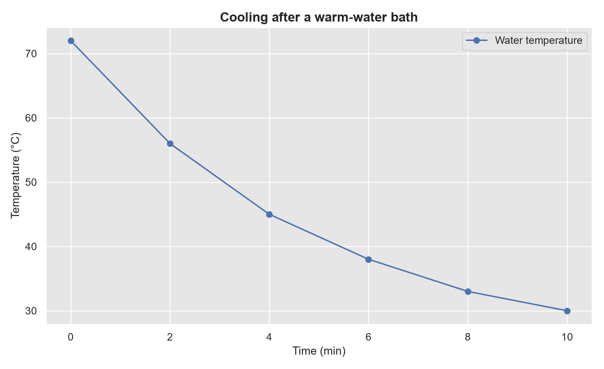
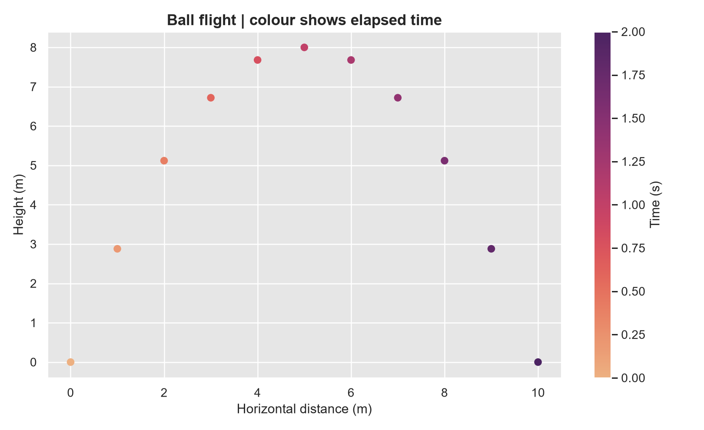
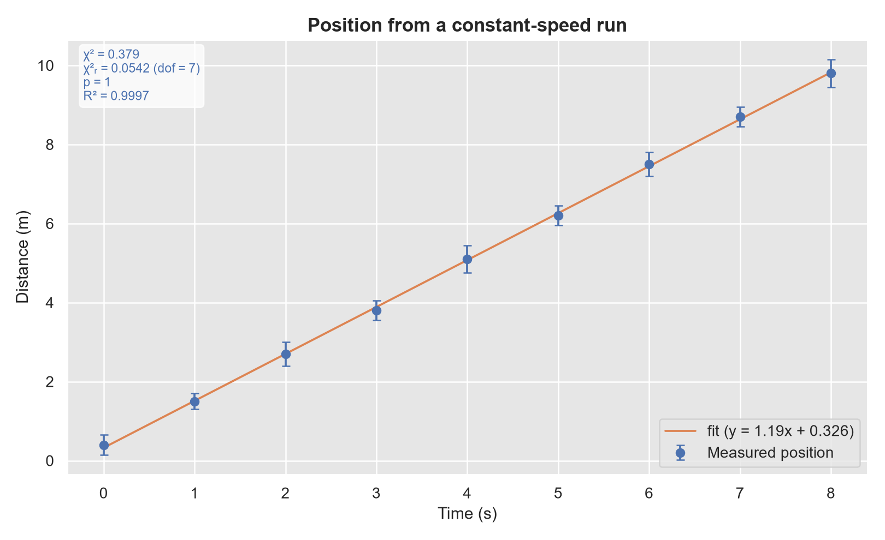
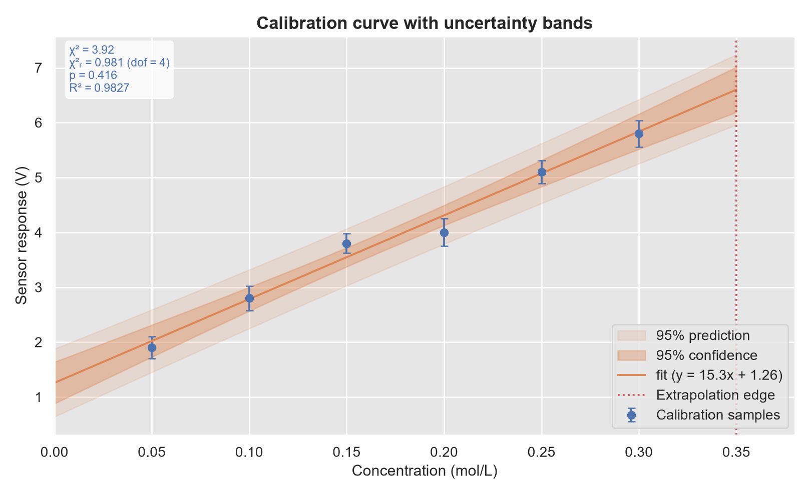
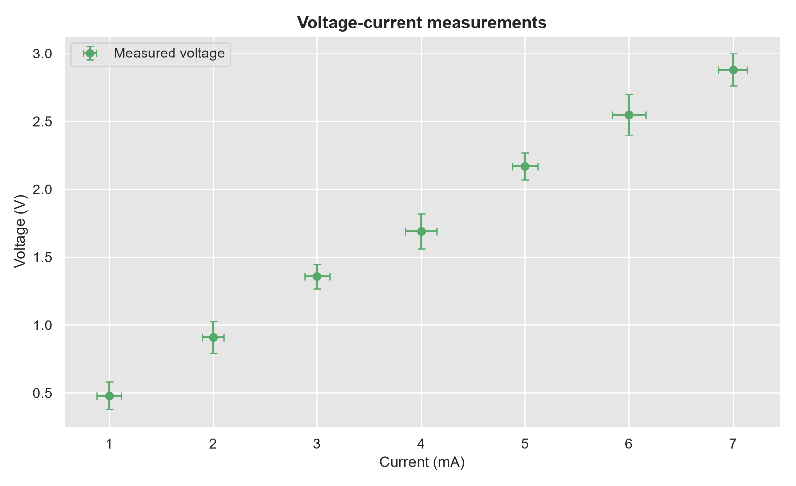
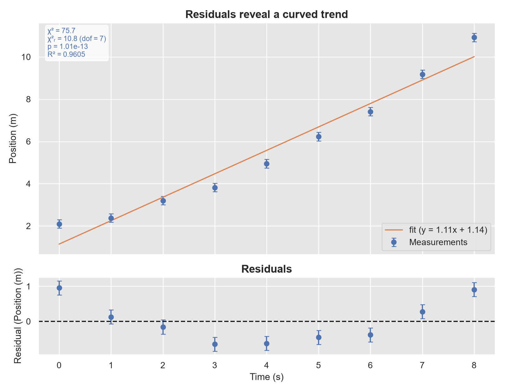
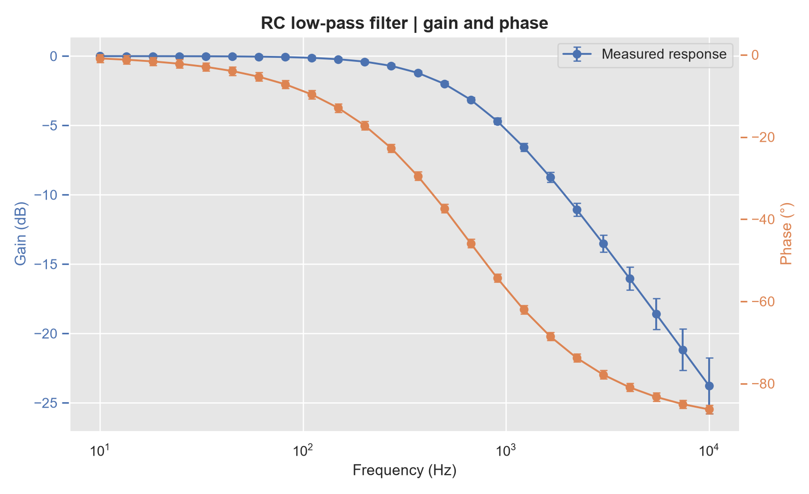

# Plotting

```python
from labplotlib import (line_plot, scatter_plot, scatter_with_fit, errorbar_plot,
                        scatter_with_residuals, scatter_with_bands, bode_plot, annotate_fit)
```

Each function returns a Matplotlib `Figure`. Inputs must be non-empty,
one-dimensional, equally sized sequences of finite values. `Measurement`
arrays and sequences of scalar measurements can also be used. Plotting
functions do not apply a global theme. They do not show or save unless
requested; if neither is requested, they do not finalize layout. Use
[`finish_plot`](styling.md)
when the figure is ready.

The figures on this page are generated by
[`generate_plots.py`](plotting_samples/generate_plots.py). Run it from the
repository root with `python docs/plotting_samples/generate_plots.py` to
regenerate the PNGs; it saves them beside the script.

## Shared parameters

The function sections below specify which of these options are available and
their defaults. Options following `*` in a signature are keyword-only.

| Parameter | Meaning |
| --- | --- |
| `x`, `y` | Horizontal and vertical data, with matching lengths. |
| `title`, `xlabel`, `ylabel` | Optional text for the axes; `None` leaves an existing label unchanged. |
| `filename` | Optional file name or path; triggers saving when supplied. |
| `save_directory` | Optional base directory for saving; defaults to the current directory and is ignored without a filename. |
| `show` | Show the figure when `True`; defaults to `False`. |
| `figsize` | Figure size in inches when creating a figure; ignored when existing axes are supplied. |
| `ax` | Optional existing Matplotlib `Axes`; its figure is returned. |
| `axes` | Optional pair `(fit_axes, residual_axes)` of distinct axes in the same figure. |
| `label` | Label for the data artist. |
| `color` | Matplotlib color for the data artist. In fit plots, defaults to the next colour in the axes' colour cycle, so each new dataset on shared axes gets a new colour. |
| `marker` | Matplotlib marker for the data artist. |
| `degree` | Positive integer polynomial degree; defaults to `1`. A fit requires at least `degree + 1` distinct x values. |
| `yerr` in fit functions | Positive finite scalar or one-dimensional sequence of y standard uncertainties, used to weight the fit and draw error bars. When omitted, uncertainty is inferred from `y` if available (see `use_errors`). |
| `xerr` in fit functions | Non-negative x uncertainties, drawn as error bars only; they do not enter the fit. When omitted, inferred from `x` if available. |
| `use_errors` | `True` by default: uncertainties carried by `Measurement` inputs are drawn and weight the fit. Set `False` to ignore them (a plain scatter and an unweighted fit). Explicit `yerr`/`xerr` always apply. |
| `model` | Optional function `model(x, *parameters)` to fit instead of a polynomial; see [fitting](fitting.md). `degree` is then ignored. |
| `p0` | Optional starting parameters for `model`; the built-in models guess their own. |
| `show_stats` | Add a text box with the fitted parameters (for models), χ², reduced χ², p-value and R². Defaults to `False`. Boxes stack downwards when several fits share axes. |
| `xscale`, `yscale` | Optional axis scale: `"linear"`, `"log"`, `"symlog"` or `"logit"`. On a log x axis the fit curve is sampled geometrically. For residual plots `yscale` applies to the data axes. |
| `fit_color` | Matplotlib color for the fitted curve; defaults to a paler shade of the data colour. |
| `label_slope` | When `True`, label the fit with the coefficient of the x term; otherwise use the degree. For nonlinear fits that coefficient is not the slope at every point. |

## `line_plot`

```text
line_plot(x, y, title=None, xlabel=None, ylabel=None, filename=None,
          save_directory=None, show=False, figsize=(8, 5), *, ax=None,
          label=None, color=None, marker=None, linestyle="-", xscale=None,
          yscale=None)
```

Draw a connected line. See the [shared parameters](#shared-parameters);
`linestyle` is a Matplotlib line style. Measurement values are used, not their
uncertainties.

**Returns:** the new or existing `Figure`.

```python
import numpy as np
from labplotlib import apply_theme, finish_plot, line_plot

time = np.arange(0, 12, 2)
temperature = [72, 56, 45, 38, 33, 30]

apply_theme()
fig = line_plot(
    time, temperature, title="Cooling after a warm-water bath",
    xlabel="Time (min)", ylabel="Temperature (°C)",
    label="Water temperature", color="C0", marker="o",
)
fig.axes[0].legend()
finish_plot(fig, filename="line_plot.png")
```



## `scatter_plot`

```text
scatter_plot(x, y, c=None, title=None, xlabel=None, ylabel=None,
             filename=None, save_directory=None, show=False, figsize=(8, 5),
             *, ax=None, label=None, color=None, marker="o", cmap=None,
             colorbar=False, colorbar_label=None, vmin=None, vmax=None,
             xscale=None, yscale=None)
```

Scatter points, optionally coloured by a third variable `c` (same length as
`x` and `y`). See the [shared parameters](#shared-parameters) and
[colormaps and colourbars](styling.md#colormaps-and-colourbars).

| Parameter | Meaning |
| --- | --- |
| `c` | Optional finite values mapped to colours. Without `c`, points use `color`. |
| `cmap` | Colormap name or `Colormap`; defaults to `"crest"` when `c` is given. |
| `colorbar` | Add a colourbar when `True`; defaults to `False`. |
| `colorbar_label` | Optional colourbar label. |
| `vmin`, `vmax` | Optional colour scale limits, useful for matching scales across figures. |

`cmap` or `colorbar` without `c` raises `ValueError`.

**Returns:** the new or existing `Figure`.

```python
import numpy as np
from labplotlib import apply_theme, finish_plot, scatter_plot

horizontal = np.linspace(0, 10, 11)
height = -0.32 * (horizontal - 5) ** 2 + 8
elapsed = np.linspace(0, 2, horizontal.size)

apply_theme()
fig = scatter_plot(
    horizontal, height, c=elapsed, cmap="flare",
    colorbar=True, colorbar_label="Time (s)",
    title="Ball flight | colour shows elapsed time",
    xlabel="Horizontal distance (m)", ylabel="Height (m)",
)
finish_plot(fig, filename="scatter_plot.png")
```



## `scatter_with_fit`

```text
scatter_with_fit(x, y, degree=1, title=None, xlabel=None, ylabel=None,
                 filename=None, save_directory=None, show=False,
                 label_slope=True, label_intercept=True, figsize=(8, 5), *,
                 ax=None, yerr=None, xerr=None, use_errors=True, model=None,
                 p0=None, show_stats=False, label="data", color=None,
                 fit_color=None, marker="o", xscale=None, yscale=None)
```

Plot observations and a fit: a polynomial by default, or any `model`. See the
[shared parameters](#shared-parameters).

- **Colours.** Data and fit share a hue: the fit is a paler shade of the data
  colour. Each new dataset on the same axes takes the next colour in the cycle
  (blue dots and pale blue line, then orange, and so on).
- **Errors.** Uncertainties on `Measurement` inputs are drawn as error bars and
  weight the fit by default. Pass `use_errors=False` to turn this off. Explicit
  `yerr` and `xerr` always apply and override inferred values.
- **Legend.** The function adds a legend.

See [`polynomial_fit`](methods.md) and [`fit_model`](fitting.md) for the
weighting and statistics.

**Returns:** the new or existing `Figure`.

```python
import numpy as np
from labplotlib import Measurement, apply_theme, finish_plot, scatter_with_fit

time = np.arange(9)
distance = Measurement(
    [0.4, 1.5, 2.7, 3.8, 5.1, 6.2, 7.5, 8.7, 9.8],
    [0.25, 0.20, 0.30, 0.25, 0.35, 0.25, 0.30, 0.25, 0.35],
)
apply_theme()
fig = scatter_with_fit(
    time, distance, title="Position from a constant-speed run",
    xlabel="Time (s)", ylabel="Distance (m)",
    label="Measured position", color="C0", fit_color="C1", show_stats=True,
)
finish_plot(fig, filename="scatter_with_fit.png")

# Ignore the Measurement's errors entirely.
fig = scatter_with_fit([0, 1, 2], Measurement([1, 3, 5.2], 0.2), use_errors=False)

# Two datasets on one axes: blue then orange, each with a paler fit line.
import matplotlib.pyplot as plt
fig, ax = plt.subplots()
scatter_with_fit([0, 1, 2], [1, 3, 5], ax=ax, label="run 1")
scatter_with_fit([0, 1, 2], [2, 4, 7], ax=ax, label="run 2")
```



## `scatter_with_bands`

```text
scatter_with_bands(x, y, title=None, xlabel=None, ylabel=None, filename=None,
                   save_directory=None, show=False, figsize=(8, 5), *, ax=None,
                   yerr=None, xerr=None, use_errors=True,
                   confidence_band=True, prediction_band=True, confidence_level=0.95,
                   confidence_uncertainty=None, prediction_uncertainty=None,
                   fit_range=None, show_stats=False, label="data", color=None,
                   fit_color=None, marker="o", xscale=None, yscale=None)
```

Plot a linear fit with pointwise confidence and prediction bands. Both bands
are shown by default; disable either with `confidence_band=False` or
`prediction_band=False`. The confidence band describes uncertainty in the
mean fitted line, while the prediction band also includes the spread of a
future observation. These are pointwise intervals, not simultaneous bands.

| Parameter | Meaning |
| --- | --- |
| `yerr` | Optional positive standard uncertainties. As with `scatter_with_fit`, errors from `Measurement` y values are used by default; explicit `yerr` overrides them. They weight the fit and are assumed to be known absolute standard deviations. |
| `use_errors` | Set to `False` to ignore inferred x and y errors; explicit errors still apply. X errors are displayed but not used in the fit or bands. |
| `confidence_level` | Two-sided interval coverage between 0 and 1; defaults to 0.95. |
| `confidence_uncertainty` | Optional externally calculated standard uncertainty of the fitted mean, either a scalar or 200 values corresponding to the fit grid. A normal critical value converts it to a confidence band. It does not change the fitted line or prediction band. |
| `prediction_uncertainty` | Optional standard deviation for a future observation, either a scalar or 200 values on the fit grid. Required when the input y uncertainties vary and a prediction band is requested. |
| `fit_range` | Optional `(minimum, maximum)` of the fitted line and bands, for example `(0, 0.25)` to extrapolate to a series limit. Values must be positive for a log x axis. |

With known y uncertainties, the weighted fit and its covariance use those
absolute uncertainties and normal critical values. A constant y uncertainty
also supplies the future-observation uncertainty unless one is specified.
Without y uncertainties, the unweighted fit estimates the residual variance
and uses Student's t critical values.
At least three points are required for an unweighted automatic band.
All calculations assume independent errors, a suitable linear model and
normally distributed residuals; extrapolation requires additional care.

```python
from labplotlib import Measurement, apply_theme, finish_plot, scatter_with_bands

x = [0.05, 0.10, 0.15, 0.20, 0.25, 0.30]
y = Measurement(
    [1.9, 2.8, 3.8, 4.0, 5.1, 5.8],
    [0.20, 0.22, 0.18, 0.25, 0.21, 0.24],
)
apply_theme()
fig = scatter_with_bands(
    x, y, title="Calibration curve with uncertainty bands",
    xlabel="Concentration (mol/L)", ylabel="Sensor response (V)",
    fit_range=(0, 0.35), prediction_uncertainty=0.25, show_stats=True,
    label="Calibration samples", color="C0", fit_color="C1",
)
ax = fig.axes[0]
ax.axvline(0.35, color="C3", linestyle=":", label="Extrapolation edge")
ax.set_xlim(0, 0.38)
ax.legend(loc="lower right")
finish_plot(fig, filename="scatter_with_bands.png")
```



The function returns a `Figure` and accepts existing `ax`, styling, error bar,
and saving options as in [`scatter_with_fit`](#scatter_with_fit).

## `annotate_fit(ax, fit, color=None)`

Add a text box to `ax` listing the fit parameters (for a `ModelFit`) and, when
available, χ², reduced χ², p-value and R². `scatter_with_fit(show_stats=True)`
calls it for you. **Returns:** `None`.

## `errorbar_plot`

```text
errorbar_plot(x, y, yerr=None, xerr=None, title=None, xlabel=None, ylabel=None,
              filename=None, save_directory=None, show=False, figsize=(8, 5),
              *, ax=None, label=None, color=None, marker="o", capsize=3,
              xscale=None, yscale=None)
```

Plot observations with optional x and y error bars. See the
[shared parameters](#shared-parameters).

| Parameter | Meaning |
| --- | --- |
| `xerr`, `yerr` | Optional finite, non-negative scalar, length-N sequence, or 2-by-N array of lower and upper errors. When omitted, uncertainty is inferred from the corresponding measurement data if available. |
| `capsize` | Error-bar cap size in points; defaults to `3`. |

**Returns:** the new or existing `Figure`. Invalid error shapes or negative
errors raise `ValueError`.

```python
from labplotlib import apply_theme, errorbar_plot, finish_plot

current = [1, 2, 3, 4, 5, 6, 7]
voltage = [0.48, 0.91, 1.36, 1.69, 2.17, 2.55, 2.88]
apply_theme()
fig = errorbar_plot(
    current, voltage,
    xerr=[0.12, 0.10, 0.12, 0.15, 0.12, 0.16, 0.14],
    yerr=[0.10, 0.12, 0.09, 0.13, 0.10, 0.15, 0.12],
    title="Voltage-current measurements",
    xlabel="Current (mA)", ylabel="Voltage (V)",
    label="Measured voltage", color="C2",
)
fig.axes[0].legend()
finish_plot(fig, filename="errorbar_plot.png")
```



## `scatter_with_residuals`

```text
scatter_with_residuals(x, y, degree=1, title=None, xlabel=None, ylabel=None,
                       filename=None, save_directory=None, show=False,
                       label_slope=True, figsize=(8, 7), *, axes=None,
                       yerr=None, xerr=None, use_errors=True, model=None,
                       p0=None, show_stats=False, label="data", color=None,
                       fit_color=None, marker="o", xscale=None, yscale=None)
```

Draw a fit (polynomial, or `model`) above residuals (`observed - predicted`).
See the [shared parameters](#shared-parameters) and
[`scatter_with_fit`](#scatter_with_fit) for colours, error handling, models and
scales. The fit is computed once and reused for the residuals. New axes share
the x axis and use a 3:1 height ratio. When uncertainties are supplied, the
lower panel shows the supplied measurement uncertainties, not fitted-residual
uncertainties.

**Returns:** the new or existing `Figure`. Invalid `axes` pairs raise
`ValueError`.

```python
import numpy as np
from labplotlib import Measurement, apply_theme, finish_plot, scatter_with_residuals

time = np.arange(9)
position = Measurement(
    0.5 + 1.1 * time + 0.10 * (time - 4) ** 2
    + np.array([0.00, -0.12, 0.10, -0.08, 0.05, 0.13, -0.09, 0.08, 0.02]),
    0.20,
)
apply_theme()
fig = scatter_with_residuals(
    time, position, title="Residuals reveal a curved trend",
    xlabel="Time (s)", ylabel="Position (m)",
    label="Measurements", show_stats=True,
)
finish_plot(fig, filename="scatter_with_residuals.png")
```



## `bode_plot`

```text
bode_plot(frequency, gain=None, phase=None, title=None, filename=None,
          save_directory=None, show=False, figsize=(8, 5), *, gain_db=None,
          ax=None, xlabel="Frequency (Hz)", gain_label="Gain (dB)",
          phase_label="Phase (°)", label=None, color=None, phase_color=None,
          marker="o", linestyle="-", xscale="log")
```

Gain in dB against frequency on a logarithmic axis, with optional phase in
degrees on a twin y axis. Axis labels are coloured to match their curves.

| Parameter | Meaning |
| --- | --- |
| `frequency` | Positive frequencies. |
| `gain` | Linear amplitude ratio (for example `Vout / Vin`), converted with `20·log10`. Give exactly one of `gain` and `gain_db`. |
| `gain_db` | Gain already in dB. |
| `phase` | Optional phase in degrees. |
| `xscale` | Frequency axis scale; `"log"` by default. |

`Measurement` uncertainties on `gain`, `gain_db` and `phase` are propagated
(for `gain`, `σ_dB = 20 σ / (g ln 10)`) and drawn as error bars. The phase axis
is `fig.axes[1]`. **Returns:** the `Figure`. A non-positive `gain`, or both or
neither of `gain` and `gain_db`, raises `ValueError`. For a −3 dB cutoff,
roll-off slope, or Q factor, see [electronics](electronics.md).

```python
import numpy as np
from labplotlib import Measurement, apply_theme, bode_plot, finish_plot

frequency = np.logspace(1, 4, 24)
gain = Measurement(1 / np.sqrt(1 + (frequency / 650) ** 2), 0.015)
phase = Measurement(-np.degrees(np.arctan(frequency / 650)), 1.0)
apply_theme()
fig = bode_plot(
    frequency, gain, phase,
    title="RC low-pass filter | gain and phase",
    label="Measured response",
)
finish_plot(fig, filename="bode_plot.png")
```


